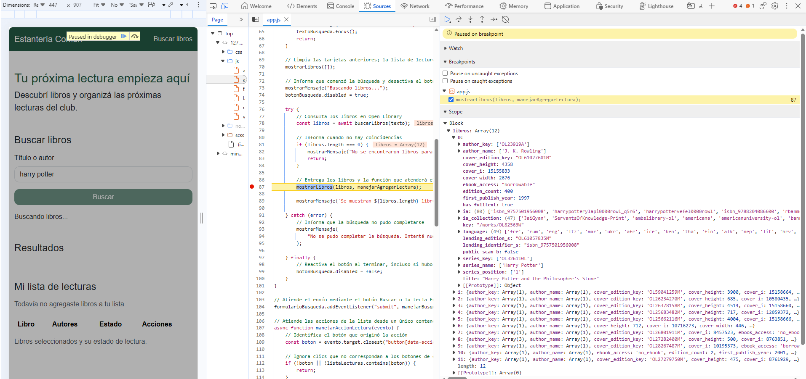
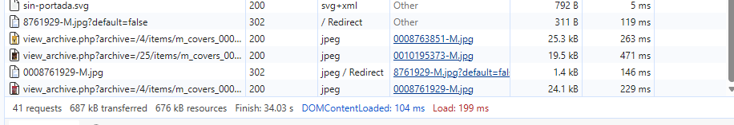
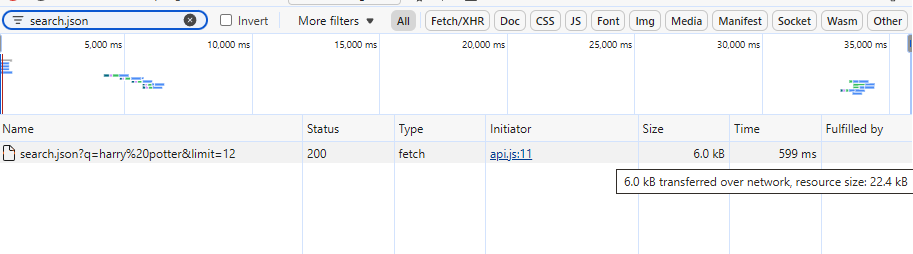
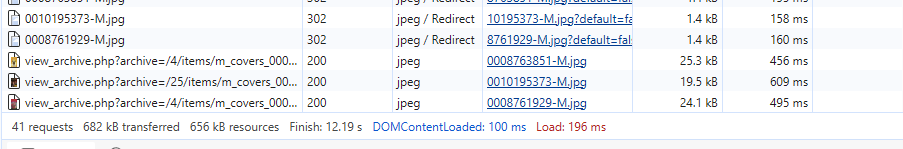
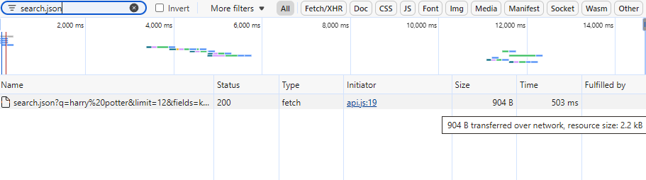

# Depuración del buscador

## Problema encontrado

Al intentar buscar un libro, no aparecían resultados y parecía que
la página se recargaba.

En la consola se observó un error 404 al intentar cargar el archivo
`js/lecturas.js`.

## Causa

El archivo se llamaba `lectura.js`, pero la importación en `app.js`
utilizaba el nombre `lecturas.js`.

Esta diferencia impedía cargar el módulo y ejecutar la inicialización
de `app.js`. Por eso no se registraba el manejador del evento submit
que controla la búsqueda y evita el envío tradicional del formulario.

## Solución aplicada

Se corrigió el nombre del archivo para que coincidiera con la
importación: `lecturas.js`.

Después de corregirlo, la búsqueda pudo ejecutarse sin recargar
la página.

## Verificación con un punto de interrupción

El error original se identificó mediante la consola. Después de
corregirlo, se utilizó un breakpoint para revisar el funcionamiento
de la búsqueda.

1. Se abrió `app.js` en el panel Sources de DevTools.
2. Se colocó un breakpoint en la llamada a
   `mostrarLibros(libros, manejarAgregarLectura)`.
3. Se realizó una búsqueda con el texto `harry potter`.
4. La ejecución se detuvo antes de mostrar las tarjetas.
5. En Scope se comprobó que `libros` era un arreglo con 12 elementos.
6. Se retiró el breakpoint y se continuó la ejecución para comprobar
   que los resultados aparecían en la página.

Mientras la ejecución estaba pausada, el mensaje “Buscando libros...”
seguía visible porque todavía no se habían ejecutado las instrucciones
que muestran los resultados y actualizan el mensaje.

## Revisión de la consola

También se detectó una solicitud fallida a `favicon.ico`. Se agregó
un enlace al archivo `img/sin-portada.svg` dentro del head del HTML
para utilizarlo como ícono de la pestaña.

Los mensajes relacionados con extensiones se revisaron en una ventana
privada con las extensiones deshabilitadas. Tras la comprobación,
la búsqueda funcionó sin los errores anteriores.

## Medición y optimización de la búsqueda

### Condiciones de la prueba

Se utilizó el panel Network de DevTools con la caché deshabilitada,
sin limitación de velocidad y sin conservar el registro entre recargas.

En ambas pruebas se buscó `harry potter`, manteniendo el mismo tamaño
de ventana y desplazándose hasta la última tarjeta para cargar las
portadas.

La medición general incluye la carga de la página y una búsqueda.

### Optimización aplicada

Se agregó el parámetro `fields` a la consulta de Open Library para
solicitar únicamente los campos utilizados por la aplicación:

- key
- title
- author_name
- first_publish_year
- cover_i
- edition_count

Se mantuvo el límite de 12 resultados.

### Resultados

| Medición | Antes | Después |
|---|---:|---:|
| Solicitudes totales | 41 | 41 |
| Transferencia total | 687 kB | 682 kB |
| Tamaño total de recursos | 676 kB | 656 kB |
| Transferencia de la búsqueda | 6,0 kB | 904 B |
| JSON descomprimido | 22,4 kB | 2,2 kB |
| Tiempo de la búsqueda | 599 ms | 503 ms |
| Estado HTTP de la búsqueda | 200 | 200 |

El tamaño del JSON descomprimido se redujo aproximadamente un 90,2 %,
calculado a partir de los valores redondeados mostrados por DevTools:

(22,4 - 2,2) / 22,4 × 100 ≈ 90,2 %

La cantidad de solicitudes no cambió porque la optimización reduce
los campos recibidos, sin eliminar solicitudes.

La reducción del peso total de la página es menor porque también
se descargan imágenes, estilos y otros archivos.

El tiempo de respuesta fue menor en esta prueba, pero una sola
comparación no demuestra una mejora constante de velocidad:
también depende de la conexión y del servidor.

### Evidencias

Antes de la optimización:

Después de la optimización:

